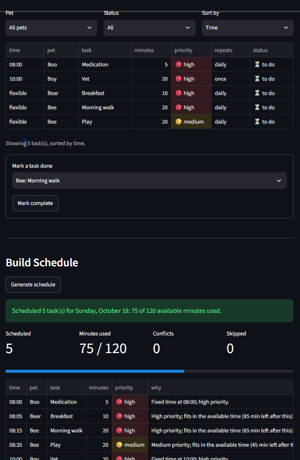

# PawPal+ (Module 2 Project)

You are building **PawPal+**, a Streamlit app that helps a pet owner plan care tasks for their pet.

## Scenario

A busy pet owner needs help staying consistent with pet care. They want an assistant that can:

- Track pet care tasks (walks, feeding, meds, enrichment, grooming, etc.)
- Consider constraints (time available, priority, owner preferences)
- Produce a daily plan and explain why it chose that plan

Your job is to design the system first (UML), then implement the logic in Python, then connect it to the Streamlit UI.

## What you will build

Your final app should:

- Let a user enter basic owner + pet info
- Let a user add/edit tasks (duration + priority at minimum)
- Generate a daily schedule/plan based on constraints and priorities
- Display the plan clearly (and ideally explain the reasoning)
- Include tests for the most important scheduling behaviors

## Getting started

### Setup

```bash
python -m venv .venv
source .venv/bin/activate  # Windows: .venv\Scripts\activate
pip install -r requirements.txt
```

### Suggested workflow

1. Read the scenario carefully and identify requirements and edge cases.
2. Draft a UML diagram (classes, attributes, methods, relationships).
3. Convert UML into Python class stubs (no logic yet).
4. Implement scheduling logic in small increments.
5. Add tests to verify key behaviors.
6. Connect your logic to the Streamlit UI in `app.py`.
7. Refine UML so it matches what you actually built.

## 🖥️ Sample Output

Paste a sample of your app's CLI or Streamlit output here so a reader can see what a generated plan looks like:

```
Today's Schedule for Jordan (Sunday, October 18)
============================================================
07:30-08:00  Mochi    Morning walk       [high]
             -> High priority; fits in the available time (65 min left after this).
08:00-08:05  Mochi    Heartworm pill     [high]
             -> Fixed time at 08:00; high priority.
08:05-08:25  Biscuit  Feather toy play   [medium]
             -> Medium priority; fits in the available time (45 min left after this).
08:25-08:40  Mochi    Brushing           [low]
             -> Low priority; fits in the available time (30 min left after this).
09:00-09:10  Biscuit  Breakfast          [high]
             -> Fixed time at 09:00; high priority.
18:00-18:10  Biscuit  Litter box         [medium]
             -> Fixed time at 18:00; medium priority.

Total: 90 of 120 available minutes used.
```

## 🧪 Testing PawPal+

```bash
# Run the full test suite:
py -m pytest

```

I tested sorting, filtering, time limits, conflict detection, recurring tasks and invalid input across various pytest tests, covering both normal use and edge cases.
Confidence level: 4.5 stars

Sample test output:

```
================================== test session starts ==================================
platform win32 -- Python 3.14.8, pytest-9.1.1, pluggy-1.6.0
rootdir: C:\Users\shane\ai110\ai110-module2show-pawpal-starter
plugins: anyio-4.15.1
collected 38 items                                                                       

tests\test_pawpal.py ......................................                        [100%]

================================== 38 passed in 0.11s ===================================
```

## 📐 Smarter Scheduling

All scheduling logic lives in `pawpal_system.py`. `Scheduler.generate_plan(on)` ties the features together: it gathers every pet's due tasks through `Owner.get_all_tasks()`, places fixed-time tasks first, fills the remaining time by priority, and records a reason for every scheduled or skipped task.

| Feature | Method(s) | Notes |
|---------|-----------|-------|
| Task sorting | `Scheduler.sort_by_priority()`, `Scheduler.sort_by_time()` | Priority: high → low, shorter task first on ties. Time: earliest `fixed_time` first, flexible tasks last (alphabetical). |
| Filtering | `Scheduler.filter_tasks()`, `Scheduler.fit_to_time()`, `Task.is_due()` | Filter by pet name, completion status, or both. Tasks that don't fit the owner's available minutes are skipped with a reason. |
| Conflict handling | `Scheduler.detect_conflicts()`, `Scheduler._find_slot()` | Warns when scheduled tasks overlap (e.g. two fixed-time tasks for different pets). Flexible tasks are placed in free gaps so they never overlap. |
| Recurring tasks | `Task.mark_complete()`, `Scheduler.complete_task()` | Completing a daily or weekly task creates the next occurrence (`timedelta` of 1 day or 7 days). One-time tasks don't repeat. |

### Sorting
- **`sort_by_priority(tasks)`** orders tasks high → medium → low; ties go to the shorter task so more tasks fit in the day. `generate_plan` uses it to decide what gets scheduled first.
- **`sort_by_time(tasks)`** orders tasks by `fixed_time`, earliest first, using `sorted()` with a tuple key. Tasks without a fixed time go last, in alphabetical order.

### Filtering
- **`filter_tasks(pet_name=None, completed=None, on=None)`** returns `(pet, task)` pairs across all pets. Pass a pet name, a completion status (done on that date, today by default), or both; leaving a filter as `None` skips it.
- **`fit_to_time(tasks, minutes)`** keeps tasks, in order, while they still fit in the time left. Tasks that don't fit become `SkippedTask`s with a reason such as "Not enough available time: needs 40 min, only 10 min left."
- **`Task.is_due(on)`** leaves out tasks that are already done or not due yet.

### Conflict detection
- **`detect_conflicts(plan)`** sorts the scheduled tasks by start time and returns a warning for every pair whose time ranges overlap, naming both tasks and pets, e.g. *"Conflict: Meds (Mochi) at 08:10 overlaps Feed (Biscuit) at 08:12."*
- The scheduler keeps both conflicting tasks and warns instead of dropping one, so the owner decides.
- **`_find_slot()`** places flexible tasks in the earliest free gap after the owner's `day_start`, so only fixed-time tasks can conflict.

### Recurring tasks
- **`Task.mark_complete(on)`** records the completion date and, for `daily` or `weekly` tasks, returns a copy due `on + timedelta(days=1)` or `on + timedelta(weeks=1)`. `once` tasks return `None`.
- **`Scheduler.complete_task(pet_name, title, on)`** completes the pet's open task and adds the next occurrence to the same pet. The completed copy stays as history.
- The next due date counts from the completion date, so a task done late shifts its cycle.


## 📸 Demo Walkthrough

1. Run `streamlit run app.py`. Set available minutes to `60` and the day start to `08:00`.
2. Add two pets: **Mochi** (dog) and **Biscuit** (cat).
3. Add tasks: Mochi **Meds** (5 min, high, 08:10), Biscuit **Feed** (10 min, high, 08:12), Mochi **Walk** (30 min, high), Biscuit **Groom** (40 min, low).
4. In **Tasks**, switch *Sort by* between Time and Priority, and filter by pet.
5. Click **Generate schedule**. The plan shows Meds 08:10, Feed 08:12 and Walk 08:22, each with a reason.
6. A warning flags that Meds and Feed overlap, and Groom is listed as skipped (not enough time).
7. Mark **Mochi: Walk** complete. A message confirms it and says the next walk is due tomorrow.
8. Stop the app (`Ctrl+C`) and run it again. Your pets, tasks and settings are still there, loaded from `pawpal_data.json`.

## Screenshot of the generated schedule for today




## Running main.py

```
All tasks (unsorted, as stored on each pet)
------------------------------------------------------------
  flexible  Mochi    Brushing           [low, to do]
  17:30     Mochi    Evening walk       [medium, to do]
  08:00     Mochi    Heartworm pill     [high, done]
  flexible  Mochi    Morning walk       [high, to do]
  08:00     Mochi    Heartworm pill     [high, to do]
  18:00     Biscuit  Litter box         [medium, to do]
  09:00     Biscuit  Breakfast          [high, to do]
  flexible  Biscuit  Feather toy play   [medium, to do]

Sorted by time (sort_by_time)
------------------------------------------------------------
  08:00     Mochi    Heartworm pill     [high, done]
  08:00     Mochi    Heartworm pill     [high, to do]
  09:00     Biscuit  Breakfast          [high, to do]
  17:30     Mochi    Evening walk       [medium, to do]
  18:00     Biscuit  Litter box         [medium, to do]
  flexible  Mochi    Brushing           [low, to do]
  flexible  Biscuit  Feather toy play   [medium, to do]
  flexible  Mochi    Morning walk       [high, to do]

Only Biscuit's tasks (filter_tasks pet_name='Biscuit')
------------------------------------------------------------
  18:00     Biscuit  Litter box         [medium, to do]
  09:00     Biscuit  Breakfast          [high, to do]
  flexible  Biscuit  Feather toy play   [medium, to do]

Completed today (filter_tasks completed=True)
------------------------------------------------------------
  08:00     Mochi    Heartworm pill     [high, done]

Mochi's tasks still to do (pet_name='Mochi', completed=False)
------------------------------------------------------------
  flexible  Mochi    Brushing           [low, to do]
  17:30     Mochi    Evening walk       [medium, to do]
  flexible  Mochi    Morning walk       [high, to do]
  08:00     Mochi    Heartworm pill     [high, to do]

Today's Schedule for Jordan (Sunday, October 18)
============================================================
07:30-08:00  Mochi    Morning walk       [high]
             -> High priority; fits in the available time (40 min left after this).
08:00-08:20  Biscuit  Feather toy play   [medium]
             -> Medium priority; fits in the available time (20 min left after this).
08:20-08:35  Mochi    Brushing           [low]
             -> Low priority; fits in the available time (5 min left after this).
09:00-09:10  Biscuit  Breakfast          [high]
             -> Fixed time at 09:00; high priority.
17:30-18:00  Mochi    Evening walk       [medium]
             -> Fixed time at 17:30; medium priority.
18:00-18:10  Biscuit  Litter box         [medium]
             -> Fixed time at 18:00; medium priority.

Total: 115 of 120 available minutes used.
```


## Stretch Features
- Professional UI and output formatting
- Advanced scheduling logic
- Data persistence layer